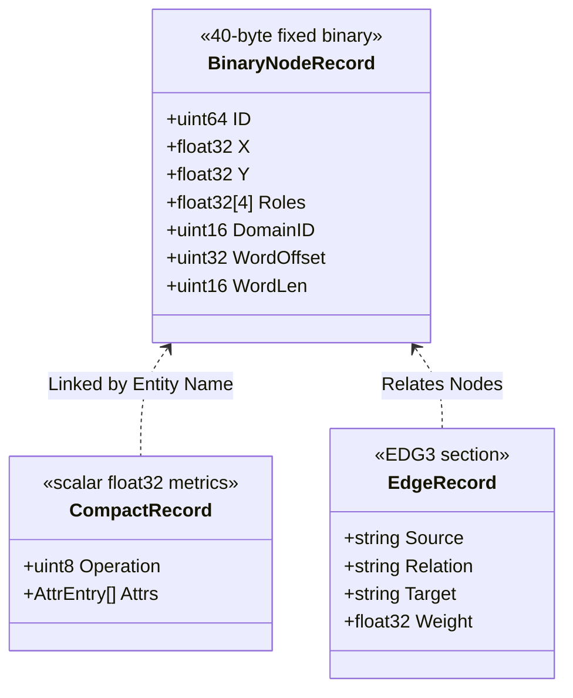

# Data Citizenship & Engine Convergence

AnchorDB unifies three distinct data paradigms into a single memory-mapped engine: **scalar entity properties**, **2D spatial manifold coordinates**, and **directed causal graphs**. 

This document explains the citizenship of each data tier, why spatial and graph engines are co-located rather than divided into separate external services, why this unified design remains lightweight on edge hardware, and how the **One Model = One File** architecture gives developers the choice between converged models and decoupled models.

---

## 1. Data Citizenship: Who is First-Class and Why?

AnchorDB is not an arbitrary JSON document store or an untyped key-value cache. It categorizes stored information into three distinct structural citizens:



### 1.1 First-Class Citizen A: Fixed 40-Byte Binary Node Records (`BinaryNodeRecord`)
Every node in AnchorDB possesses a fixed 40-byte binary slot laid out contiguously on disk and memory-mapped via `mmap(MAP_SHARED)`:
* **Byte `0..7` (`ID`)**: Monotonic 64-bit identifier.
* **Byte `8..11` (`X`)**: 32-bit floating point Cartesian coordinate or longitude.
* **Byte `12..15` (`Y`)**: 32-bit floating point Cartesian coordinate or latitude.
* **Byte `16..31` (`Roles`)**: 4-dimensional vector `[Subject, Predicate, Object, Modifier]` representing semantic orientation.
* **Byte `32..33` (`DomainID`)**: Numerical domain partition boundary.
* **Byte `34..39` (`WordOffset` & `WordLen`)**: Byte offset and length pointing into the string intern pool.

**Why is it first-class?**
By fixing the size to exactly 40 bytes, spatial algorithms (such as Fast Voxel DDA ray marching and euclidean distance calculations) bypass JSON deserialization, pointer chasing, and heap allocations. The CPU reads coordinate offsets directly from the memory-mapped virtual memory window into CPU floating-point registers.

### 1.2 First-Class Citizen B: Scalar Entity Metrics (`CompactRecord`)
User-defined properties and business metrics (`temperature`, `speed`, `battery_level`, `date`) are stored in `CompactRecord` structs:
* Every attribute value is a compact `float32` scalar (supporting floats, integers, booleans, and epoch days).
* Fields are validated against an immutable model contract (`ModelSchema`).
* Attributes are interned into numerical IDs to avoid string repetition.

**Why is it first-class?**
Vectorized in-storage arithmetic (`+`, `-`, `*`, `/`) and date difference computations execute directly over contiguous memory arrays without materializing intermediary objects.

### 1.3 First-Class Citizen C: Directed Causal Edges (`EdgeRecord`)
Cause-and-effect connections (`Source --Relation--> Target` with a `Weight`) reside in the dedicated `EDG3` binary trailer:
* Indexed in-memory via forward and backward adjacency maps (`adjOut`, `adjIn`).
* Persisted to the Write-Ahead Log (WAL) via dedicated opcodes (`WalOpEdge`, `WalOpEdgeDelete`).
* Maintained across lifecycle compactions.

**Why is it first-class?**
Real-world systems do not just observe static measurements; they require real-time causal inference to determine *why* a state occurred and *what* consequences follow.

---

## 2. Why Combine Spatial Data and Graph Traversal in One Engine?

In traditional systems architecture, developers are taught to separate concerns by running dedicated database engines:

```
[ Traditional Three-Database Stack ]
Application Server
    ├──> PostgreSQL (Relational & Metric Storage)
    ├──> PostGIS / Redis-GEO (Spatial Search)
    └──> Neo4j / AWS Neptune (Graph Traversals)
```

For edge devices, autonomous vehicles, industrial robotics, and distributed gateways, this multi-engine pattern introduces fatal architectural penalties:

1. **The Three-Database Network Tax**:
   Evaluating a single physical event requires querying three different databases over network sockets, serializing/deserializing payloads three times, and paying multiple round-trip latencies.
2. **Distributed Consistency Nightmare**:
   If an edge drone moves to coordinate `(X, Y)`, records a low-battery event, and triggers an emergency landing rule, coordinating transactions across three independent databases with WAL guarantees is fragile and prone to partial failure.
3. **Hardware Resource Exhaustion on the Edge**:
   Running a JVM-based graph engine (e.g. Neo4j needing 2GB–4GB of RAM) alongside a relational engine and spatial index exhausts the compute budget of edge gateways (such as Raspberry Pi, NVIDIA Jetson, or ARM embedded controllers).

### The Converged Reality: Unified Spatial-Causal Reasoning
In physical environments, **location, telemetry, and causality are inseparable dimensions of the same entity**:
* A delivery robot is at coordinate `(106.8272, -6.1754)` *(Spatial)*.
* Its speed is `2.4 m/s` and temperature is `74.5°C` *(Entity Metrics)*.
* Its temperature rise triggers an automated fan shutdown *(Causal Relationship)*.

AnchorDB combines these primitives into one engine so an application can evaluate:

> **Spatial Proximity** × **Metric Filter** × **Causal Chain**

in a single in-memory pass taking under 5 microseconds.

---

## 3. Is It Heavy? Why Not Separate Them into Standalone Engines?

A common architectural skepticism is: *"Stuffing spatial ray-casting and causal graphs into an embedded engine must make it heavy and bloated."*

AnchorDB avoids bloat by refusing to implement heavy database abstractions. The table below details why the converged engine remains lightweight:

| Dimension | Heavy External Engine Approach | AnchorDB Converged Approach |
| :--- | :--- | :--- |
| **Spatial Indexing** | R-Tree / B-Tree with dynamic node splitting, pointer chasing, and heap allocations. | **Fast Voxel DDA (Amanatides & Woo)** on a uniform 256 × 256 grid. Traversal steps use in-register integer arithmetic with **zero heap allocations**. |
| **Graph Modeling** | Property graphs with complex node labels, edge properties, and dynamic index lookups. | **Flat Adjacency Arrays (`EDG3`)**: 40-byte records connecting interned word keys. 100,000 edges require only ~4 MB of RAM. |
| **Memory Management** | Heavy internal caching (LRU, buffer pools, JVM garbage collector). | **OS Virtual Memory (`mmap`)**: Zero-copy reads. The Linux kernel page cache automatically manages page eviction. |
| **Concurrency Overhead** | Distributed locks, two-phase commits, and cross-database RPCs. | **Single RW-Mutex**: Readers execute concurrently using `RLock()` without blocking write paths. |

AnchorDB does not include a SQL query planner, relational table joins, or dynamic document parsing. By confining properties to fixed `float32` vectors and using integer grid ray-casting, the entire binary compiles to a lightweight, self-contained standalone executable (~20 MB).

---

## 4. Built on Real-World Need: The Problem with Artificial Separation

Architectural purity for the sake of separation creates unnecessary complexity. When an engineer's operational need requires evaluating spatial relationships and causal dependencies together, forcing them into separate systems creates artificial boundaries:

* **Separation increases failure modes**: Network partitions between the spatial database and the graph database break query execution.
* **Separation inflates operational cost**: Managing three systemd services, three monitoring scrapers, and three backup routines on every edge node multiplies maintenance overhead.
* **Separation destroys latency guarantees**: Passing intermediate candidate IDs across TCP sockets adds milliseconds of overhead where sub-microsecond response times are needed.

AnchorDB unifies these data types because **edge compute requires deterministic, unified, single-process execution**.

---

## 5. Architectural Flexibility: Converged Models vs Decoupled Models

AnchorDB enforces the **One Model = One File** architecture. Each model (`/data/{model}.anchordb`) is an entirely isolated database instance with its own header, its own file lock, its own WAL file, and its own partition retention schedule.

Because of this file-level isolation, **AnchorDB never forces you into a monolithic design**. You can choose between two deployment topologies based on your system requirements:

```
Pattern A: Converged Model (Tightly Coupled)
/data/fleet_operations.anchordb
    ├── Entity Records: Speed, Battery, Timestamp
    ├── Spatial Grid: Real-time GPS Coordinates
    └── Causal Edges: Failure & Warning Rules

-----------------------------------------------------------

Pattern B: Decoupled Multi-Model (Separation of Concerns)
/data/telemetry.anchordb    --> Scalar Metrics & Time-Series Logs
/data/geofences.anchordb    --> Polygons, Waypoints, & Spatial Manifold
/data/ontology.anchordb     --> Causal Rules & Semantic Relationships
```

### Pattern A: Converged Model (All-in-One)
Best for workloads where an entity's position, telemetry, and causal status are constantly queried together:
* **Example**: Drone navigation, warehouse automated guided vehicles (AGV), smart farming sensors.
* **Benefits**: Maximum query performance; single atomic WAL flush for coordinate and property updates; zero coordination overhead.

### Pattern B: Decoupled Multi-Model (Domain Segregation)
Best for workloads where teams or services require strict lifecycle and retention separation:
* **`telemetry.anchordb`**: Holds high-frequency sensor readings with an aggressive 30-day S3 partition retention policy (`RetentionDays = 30`).
* **`geofences.anchordb`**: Holds static geographical boundary polygons and waypoints that never expire.
* **`ontology.anchordb`**: Holds static cause-and-effect rules shared across the entire enterprise.

Because the Go driver and HTTP API support multi-model routing via `client.Model("model_name")`, switching between a converged model and a decoupled model requires zero changes to the underlying storage engine.

---

## 6. Summary

AnchorDB treats spatial coordinates and causal edges as first-class citizens alongside scalar entity properties because real-world edge intelligence demands all three. 

By grounding spatial traversal in Fast Voxel DDA algorithms and causal traversal in compact contiguous arrays, AnchorDB delivers multi-model capability without the operational weight or memory footprint of traditional database clusters. Developers retain complete freedom to consolidate these domains into a single converged model or isolate them across dedicated model files.
