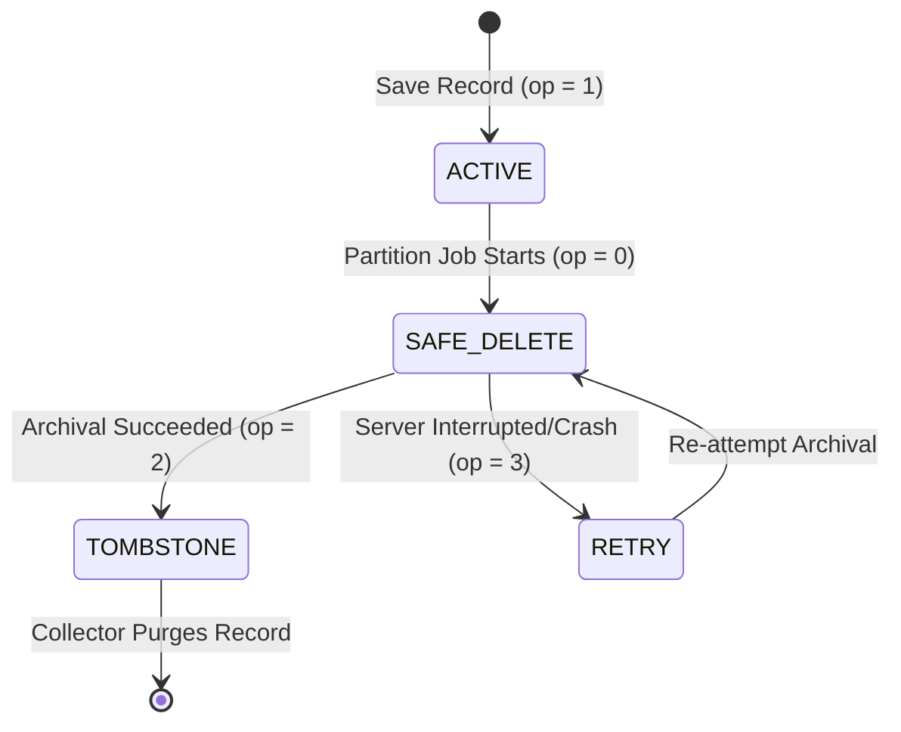

# Data Partitioning & Record Lifecycle

AnchorDB provides an automated data lifecycle engine designed to archive historical records into isolated partition files without interrupting active queries.

---

## 1. Four-State Record Lifecycle Machine

To prevent data loss or silent omissions if a server terminates mid-archival, records follow a deterministic four-state lifecycle:



| Opcode | State | Description | Behavior |
| :---: | :--- | :--- | :--- |
| **`1`** | **ACTIVE** | Normal operational record. | Queryable by reads; eligible for mutations and updates. |
| **`0`** | **SAFE_DELETE** | Partition lock state. | Locked against mutations; excluded from normal queries while the partition file is being constructed. |
| **`2`** | **TOMBSTONE** | Successfully archived. | Excluded from lookups; queued for cleanup by the background collector. |
| **`3`** | **RETRY** | Interrupted or failed archival. | If a crash occurs while records are in state `0`, startup reconciliation automatically promotes them to `3`. The next partition run will retry archiving them. |

---

## 2. Partition Policies & Execution

A partition job isolates records older than a configured retention threshold based on a date field.

### Configuration (`PartitionPolicy`)
* **`ModelName`**: Model identifier (e.g. `"transactions"`).
* **`DateField`**: Attribute holding epoch days (default `"date"`).
* **`RetentionDays`**: Number of days records remain in hot storage (e.g. `180` for 6 months).
* **`Sink`**: Storage destination (`LocalDiskSink` or `S3Sink`).
* **`PruneHotDB`**: When `true`, archived records are transitioned to Tombstone state.

### Execution Flow
1. **Candidate Lock**: Candidates where `date <= today - RetentionDays` are identified and atomically transitioned from `ACTIVE (1)` to `SAFE_DELETE (0)`.
2. **Streaming Serialization**: Partition records are written to a temporary `.anchordb` file on disk.
3. **Sink Transfer**: The file is transferred to the configured sink.
4. **State Transition**: If transfer fails, records transition to `RETRY (3)`. On success with `PruneHotDB=true`, records pass through `TOMBSTONE (2)`, are collected immediately, and the hot database is synced. With `PruneHotDB=false`, they return to `ACTIVE (1)`.

---

## 3. Supported Partition Sinks

### 1. Local Disk Sink (`LocalDiskSink`)
Stores partitions in a local directory (e.g., `./data/partitions/`):
```go
sink := partition.NewLocalDiskSink("./data/partitions")
```
* Writes to a temporary staging file first.
* Publishes the synced staging file with `os.Link`, so an existing archive is not overwritten. If the requested filename already exists, the sink adds a UUID suffix.

### 2. S3 Object Storage Sink (`S3Sink`)
Streams partition files to AWS S3, MinIO, or compatible storage:
```go
sink := partition.NewS3Sink(
    "https://s3.us-east-1.amazonaws.com",
    "my-archive-bucket",
    "anchordb/partitions/",
    os.Getenv("AWS_ACCESS_KEY_ID"),
    os.Getenv("AWS_SECRET_ACCESS_KEY"),
)
sink.Region = "us-east-1"
```
* **Streaming SigV4**: Computes payload hashes in a single pass without buffering multi-gigabyte partitions in RAM.
* **Server-side SSRF Guard**: The REST partition endpoint rejects S3 endpoints resolving to private or link-local IP addresses unless `ANCHORDB_ALLOW_S3_PRIVATE_ENDPOINT=true` is set. Direct use of `NewS3Sink` does not perform that server-side check.

---

## 4. Tombstone Garbage Collection

Records marked `TOMBSTONE (2)` remain in hot storage until collected. A successful partition run with `PruneHotDB=true` invokes the collector immediately; other tombstones can be removed by scheduled or manual collection.

### Triggering Collection
Collection can be initiated:
1. **Automatically**: Periodic background cleanup runs during scheduled sync windows.
2. **Via the HTTP administration API** (the Wire backend does not start collector jobs):
```bash
curl -X POST http://localhost:7447/v1/collector/run \
  -H "Authorization: Bearer $ANCHORDB_AUTH_TOKEN" \
  -H "Content-Type: application/json" \
  -d '{"model": "transactions", "async": true}'
```

The collector removes references from `EntityStore`, updates the spatial index, and flushes changes to disk.

---

## 5. Cold Partition Inspection Through Engine

Archived partitions are structured `.anchordb` binary files, but they are never meant to be opened directly by client file descriptors. The AnchorDB Engine exposes authenticated inspection endpoints and driver methods:

```go
// List available partition files
partitions, err := client.ListPartitions(ctx)

// Inspect a specific cold record via the engine
coldRec, err := client.InspectPartitionRecord(ctx, "2026-10-16_part1.anchordb", "sensor_archive_old_1")
```

Partition listing and inspection are not implemented by the AnchorWire driver backend. Use the authenticated HTTP administration endpoints when those operations are needed:
```bash
# List partitions
curl -H "Authorization: Bearer $ANCHORDB_AUTH_TOKEN" http://localhost:7447/v1/partition/list

# Inspect record
curl -X POST http://localhost:7447/v1/partition/inspect \
  -H "Authorization: Bearer $ANCHORDB_AUTH_TOKEN" \
  -H "Content-Type: application/json" \
  -d '{"partition_file": "2026-10-16_part1.anchordb", "name": "sensor_archive_old_1"}'
```

---

## 6. Design Boundaries & Limitations

1. **Archive Writes**: The local sink does not overwrite an existing filename. Archived files are inspected read-only through the engine; inserts and in-place updates are not exposed there. The S3 sink currently uses an ordinary PUT, so an object with the same key can be replaced; use unique filenames or bucket versioning when that matters.
2. **Date Field Requirement**: Automated partition archival requires an integer or float32 epoch-day attribute (e.g. `MustDate("YYYY-MM-DD")`). Records without a recognizable date attribute are not eligible for automated date-cutoff archival.
3. **Engine-Mediated Inspection**: Direct host volume mounts of `/data/partitions` must not be read with raw file open calls; queries should always be routed through `client.InspectPartition` or `/v1/partition/inspect`.

