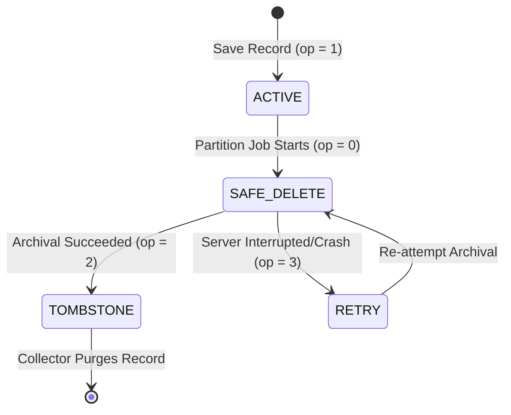

# Data Partitioning & Record Lifecycle

AnchorDB provides an automated data lifecycle engine designed to archive historical records into isolated partition files without interrupting active queries.

---

## 1. Four-State Record Lifecycle Machine

To prevent data loss or silent omissions if a server terminates mid-archival, records follow a deterministic four-state lifecycle:



| Opcode | State | Description | Behavior |
| :---: | :--- | :--- | :--- |
| **`1`** | **ACTIVE** | Normal operational record. | Queryable by reads; eligible for mutations and updates. |
| **`0`** | **SAFE_DELETE** | Partition lock state. | Locked against mutations; excluded from normal queries while the partition file is being constructed. |
| **`2`** | **TOMBSTONE** | Successfully archived. | Excluded from lookups; queued for cleanup by the background collector. |
| **`3`** | **RETRY** | Interrupted or failed archival. | If a crash occurs while records are in state `0`, startup reconciliation automatically promotes them to `3`. The next partition run will retry archiving them. |

---

## 2. Partition Policies & Execution

A partition job isolates records older than a configured retention threshold based on a date field.

### Configuration (`PartitionPolicy`)
* **`ModelName`**: Model identifier (e.g. `"transactions"`).
* **`DateField`**: Attribute holding epoch days (default `"date"`).
* **`RetentionDays`**: Number of days records remain in hot storage (e.g. `180` for 6 months).
* **`Sink`**: Storage destination (`LocalDiskSink` or `S3Sink`).
* **`PruneHotDB`**: When `true`, archived records are transitioned to Tombstone state.

### Execution Flow
1. **Candidate Lock**: Candidates where `date <= today - RetentionDays` are identified and atomically transitioned from `ACTIVE (1)` to `SAFE_DELETE (0)`.
2. **Streaming Serialization**: Partition records are written to a temporary `.anchordb` file on disk.
3. **Sink Transfer**: The file is transferred to the configured sink.
4. **State Transition**: Upon sink confirmation, records in hot storage are updated from `0` to `TOMBSTONE (2)`. If transfer fails, records transition to `RETRY (3)`.

---

## 3. Supported Partition Sinks

### 1. Local Disk Sink (`LocalDiskSink`)
Stores partitions in a local directory (e.g., `./data/partitions/`):
```go
sink := partition.NewLocalDiskSink("./data/partitions")
```
* Writes to a temporary staging file first.
* Uses atomic `os.Rename` to finalize storage.

### 2. S3 Object Storage Sink (`S3Sink`)
Streams partition files to AWS S3, MinIO, or compatible storage:
```go
sink, err := partition.NewS3Sink(partition.S3Config{
    Endpoint:  "s3.us-east-1.amazonaws.com",
    Bucket:    "my-archive-bucket",
    Prefix:    "anchordb/partitions/",
    AccessKey: os.Getenv("AWS_ACCESS_KEY_ID"),
    SecretKey: os.Getenv("AWS_SECRET_ACCESS_KEY"),
    Region:    "us-east-1",
})
```
* **Streaming SigV4**: Computes payload hashes in a single pass without buffering multi-gigabyte partitions in RAM.
* **SSRF Guard**: Rejects endpoints resolving to private or link-local IP addresses unless `ANCHORDB_ALLOW_S3_PRIVATE_ENDPOINT=true` is set.

---

## 4. Tombstone Garbage Collection

Records in the `TOMBSTONE (2)` state remain in hot storage until swept by the collector. This separation ensures query performance remains consistent during peak hours by deferring cleanup passes.

### Triggering Collection
Collection can be initiated:
1. **Automatically**: Periodic background cleanup runs during scheduled sync windows.
2. **Via REST API**:
```bash
curl -X POST http://localhost:7447/v1/collector/run \
  -H "Authorization: Bearer $ANCHORDB_AUTH_TOKEN" \
  -H "Content-Type: application/json" \
  -d '{"model": "transactions", "async": true}'
```

The collector removes references from `EntityStore`, updates the spatial index, and flushes changes to disk.
