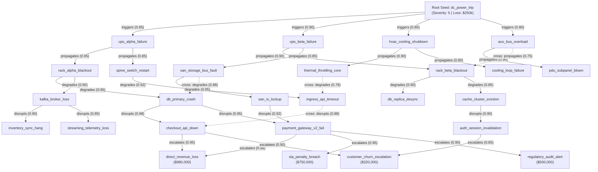

# Example: Multi-Branching Graph Traversal vs Schema

This example demonstrates how AnchorDB unifies **Strict Model Schema Contracts** with **Directed Causal Graph Traversal** across a multi-branching mesh network (not a single linear chain).

It showcases:
1. **Schema Contract Enforcement**: Declaring and locking typed node properties (`severity`, `impact_usd`, `latency_ms`, `is_critical`).
2. **Multi-Branching DAG Network**: Constructing 35 weighted directed causal edges across 5 relational tiers (`triggers`, `propagates`, `degrades`, `disrupts`, `escalates`) with path fan-out and re-convergent bottlenecks.
3. **Multi-Hop Traversal (1-Hop to 5-Hops)**: Computing cumulative path probabilities ($Score = \prod Weight$) with automatic frontier deduplication (`highest incoming score`).
4. **Concurrent Stress Testing**: Measuring read-lock traversal throughput and latency under high-concurrency multi-worker loads (hundreds of thousands of traversals/second; scales with available CPU cores).
5. **Schema-Enforced Resolution**: Inspecting reached nodes using `client.Get()` and performing in-storage arithmetic filtering using `client.List().Compute()`.

---

## Architecture: Graph Traversal vs Schema

In AnchorDB, **Schema** and **Graph Traversal** have an orthogonal separation of concerns that work synergistically:

```
+-------------------------------------------------------------------------------+
|                             ANCHORDB MODEL ENGINE                             |
+-------------------------------------------------------------------------------+
        |                                                               |
        v                                                               v
+-------------------------------+               +-------------------------------+
|      MODEL SCHEMA CONTRACT    |               |      CAUSAL GRAPH TOPOLOGY    |
|       (Entity Node State)     |               |      (Inter-Node Relations)   |
+-------------------------------+               +-------------------------------+
| • Governs internal attributes |               | • Governs cause & effect      |
| • Enforces types: int, float, |               | • Directed edges: S -> R -> T |
|   bool, date                  |               | • Floating-point weights [0,1]|
| • Blocks typos and corruption |               | • Multi-hop chain reasoning   |
| • Evaluated on Save / Update  |               | • Evaluated on CausalChain    |
+-------------------------------+               +-------------------------------+
        |                                                               |
        +-------------------------------+-------------------------------+
                                        |
                                        v
                    +---------------------------------------+
                    |        UNIFIED QUERY EXECUTION        |
                    | 1. Traversal finds impacted targets   |
                    | 2. Path score calculates probability  |
                    | 3. Get / List resolves typed entity   |
                    | 4. In-storage math evaluates impact   |
                    +---------------------------------------+
```

* **Schema** guarantees that every entity stored in the database has guaranteed, valid, non-null properties.
* **Graph Traversal** discovers dynamically which entities are affected across multiple relational hops.
* **Combined Benefit**: When your application traverses the graph, you can immediately query and perform arithmetic math on the reached entities with 100% confidence that no attributes are missing or malformed.

---

## Failure Propagation Topology (Multi-Branching Mesh DAG)

Instead of a trivial 1-line chain (`A -> B -> C -> D`), this example implements an enterprise datacenter failure propagation DAG with multi-thread fan-out and cross-linked bottleneck convergence:



---

## How to Run

Execute directly from the repository root:

```bash
go run ./examples/graph_traversal
```

---

## Code Walkthrough

### 1. Attaching Schema
```go
schema := driver.Schema{
    "severity":    "int",     // Required integer (1-5)
    "impact_usd":  "float",   // Required float32 (monetary impact)
    "latency_ms":  "float",   // Required float32 (latency degradation)
    "is_critical": "bool",    // Required bool (1.0 or 0.0)
    "tier":        "int?",    // Optional integer attribute
}

err := client.Attach(schema)
```

### 2. Linking Directed Weighted Edges
```go
// Hop 1: triggers (Fan-out into 4 concurrent threads)
_ = client.Link("dc_power_trip", "triggers", "ups_alpha_failure", 0.95)
_ = client.Link("dc_power_trip", "triggers", "ups_beta_failure", 0.90)
_ = client.Link("dc_power_trip", "triggers", "hvac_cooling_shutdown", 0.85)
_ = client.Link("dc_power_trip", "triggers", "aux_bus_overload", 0.80)

// Hop 2 to 5: propagates, degrades, disrupts, escalates (including cross-edges)
_ = client.Link("ups_alpha_failure", "propagates", "rack_alpha_blackout", 0.95)
...
```

### 3. Executing Multi-Hop Causal Reasoning
```go
seed := []string{"dc_power_trip"}

// 5-Hop Traversal across sequential relations
rels := []string{"triggers", "propagates", "degrades", "disrupts", "escalates"}
results, err := client.CausalChain(seed, rels, 5)

for rank, r := range results {
    fmt.Printf("[%d] Target: %s | Cumulative Probability: %.4f\n", rank+1, r.Word, r.Score)
}
```

### 4. Resolving Reached Nodes via `Get` and `List`
```go
// A. Direct point resolution on discovered node
node, _ := client.Get("direct_revenue_loss").Execute(ctx)
fmt.Println("Severity:", node.Get("severity"))
fmt.Println("Impact USD:", node.Get("impact_usd"))

// B. In-storage math projection on impacted nodes
list, _ := client.List().
    Where("severity", ">=", 4.0).
    Compute("risk_index", driver.Multiply("impact_usd", "severity")).
    Execute(ctx)
```

---

## How to Run (AnchorWire Binary TCP Protocol)

Ensure the AnchorDB server daemon is running with AnchorWire listening on port `7448`:

```bash
go run ./examples/graph_traversal -url=wire://localhost:7448
```

---

## Expected Output & Benchmark Results

### 1. Multi-Hop Traversal Scores & Latencies

| Hop Depth | Relations Traversed | Nodes Reached | Top Target | Cumulative Score | Latency |
| :---: | :--- | :---: | :--- | :---: | :---: |
| **Hop 1** | `["triggers"]` | 4 nodes | `ups_alpha_failure` | **0.9500** | **~5.5 µs** |
| **Hop 2** | `[... "propagates"]` | 7 nodes | `rack_alpha_blackout` | **0.9025** | **~4.2 µs** |
| **Hop 3** | `[... "degrades"]` | 6 nodes | `db_primary_crash` | **0.8574** | **~4.9 µs** |
| **Hop 4** | `[... "disrupts"]` | 5 nodes | `checkout_api_down` | **0.8402** | **~6.1 µs** |
| **Hop 5** | `[... "escalates"]`| 4 nodes | `direct_revenue_loss` | **0.7982** | **~11.3 µs** |

> Scores and node counts are deterministic. Latency figures are indicative only and vary with host hardware, Go runtime version, and cache warm-up state.

### 2. Multi-Worker Concurrent Throughput (100,000 Queries)

| Goroutines (Workers) | Total Queries | Latency | Traversal Throughput |
| :---: | :---: | :---: | :---: |
| **1 Worker** | 100,000 | 4.50 µs / op | **222,433 ops/sec** |
| **4 Workers** | 100,000 | 1.45 µs / op | **689,019 ops/sec** |
| **16 Workers** | 100,000 | 1.26 µs / op | **796,563 ops/sec** |
| **64 Workers** | ~100,000 | 1.02 µs / op | **978,147 ops/sec** *(Peak)* |

> Historical sample figures only; they are not generated by every run and depend on host/runtime conditions. The current example requires all 100,000 queries at each worker level to succeed; it exits non-zero if an error or shortfall occurs.

### 3. Schema-Guaranteed Resolution Tables

#### Top Impacted Nodes (`client.Get`):
```
Entity Name                  | Severity | Impact (USD) | Latency (ms) | Is Critical
---------------------------------------------------------------------------------
payment_gateway_v2_fail      | 5        | $450000.00   | 6000.0       | 1
db_primary_crash             | 5        | $180000.00   | 2500.0       | 1
direct_revenue_loss          | 5        | $980000.00   | 0.0          | 1
sla_penalty_breach           | 5        | $750000.00   | 0.0          | 1
```

#### In-Storage Arithmetic List Query (`impact_usd * severity`):
`Where("severity", ">=", 4.0).Compute("risk_index", Multiply("impact_usd","severity")).Page(1, 15)`

```
Matching Entities Count: 15 (HasMore: true)

Entity Name                  | Severity | Impact (USD) | Risk Index (Math) | Is Critical
----------------------------------------------------------------------------------------
dc_power_trip                | 5        | $250000.00   | $1250000.00    | 1
ups_alpha_failure            | 5        | $120000.00   | $600000.00     | 1
ups_beta_failure             | 4        | $90000.00    | $360000.00     | 1
hvac_cooling_shutdown        | 4        | $75000.00    | $300000.00     | 1
rack_alpha_blackout          | 5        | $80000.00    | $400000.00     | 1
rack_beta_blackout           | 4        | $65000.00    | $260000.00     | 1
spine_switch_restart         | 4        | $50000.00    | $200000.00     | 1
cooling_loop_failure         | 4        | $45000.00    | $180000.00     | 1
san_storage_bus_fault        | 5        | $95000.00    | $475000.00     | 1
db_primary_crash             | 5        | $180000.00   | $900000.00     | 1
db_replica_desync            | 4        | $60000.00    | $240000.00     | 1
kafka_broker_loss            | 5        | $110000.00   | $550000.00     | 1
san_io_lockup                | 5        | $140000.00   | $700000.00     | 1
ingress_api_timeout          | 4        | $55000.00    | $220000.00     | 1
checkout_api_down            | 5        | $300000.00   | $1500000.00    | 1
```
